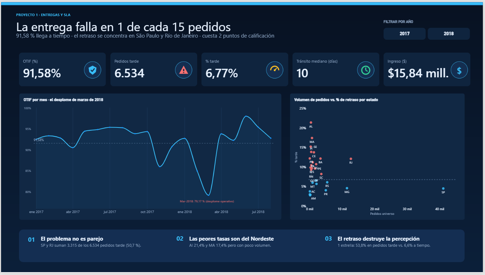
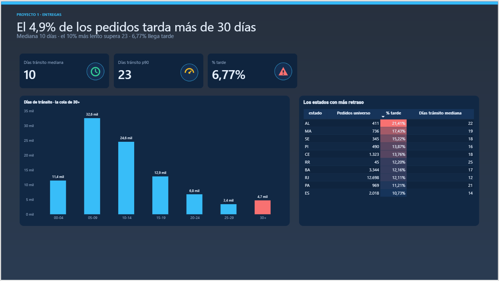
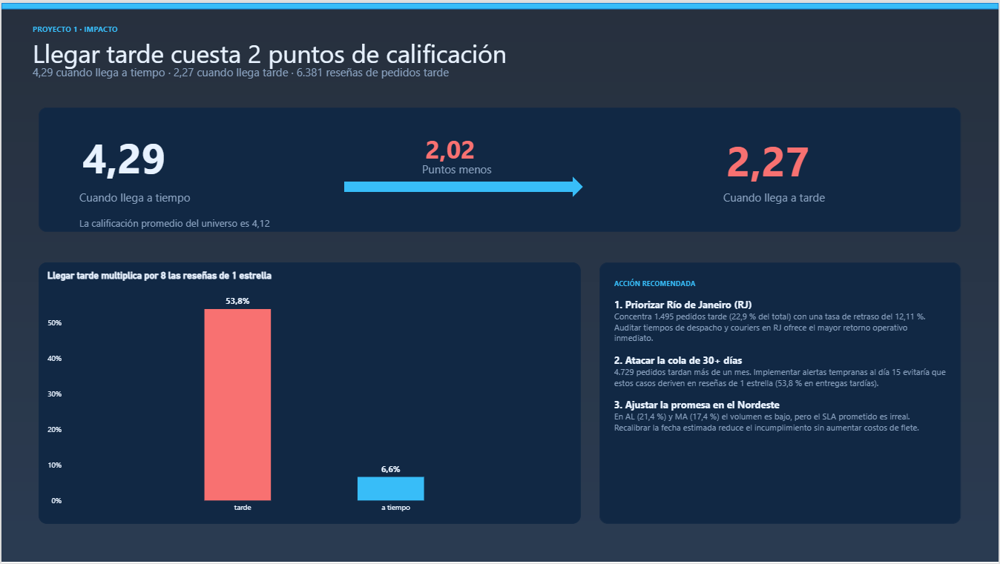

# Entregas y SLA — Análisis de Operaciones Logísticas

Análisis de **99.441 pedidos** de un marketplace brasileño real (Olist, 2016–2018) para diagnosticar el cumplimiento de entregas, identificar dónde se concentran los retrasos y medir su impacto directo en la satisfacción del cliente.

**Stack:** PostgreSQL 18 · SQL · Power BI Desktop (DAX / Modelado Estrella)  
**Perfil:** Analista BI / Analista de Datos de Operaciones  
**Estado:** Completado y validado (22 controles SQL cuadrados en `05_validation/01_cuadre.sql`)

---

## El problema de negocio

En comercio electrónico, la experiencia que el cliente recuerda no es la compra: es la entrega. La fecha estimada que se muestra al pagar es una promesa operativa. Cuando esa promesa se rompe, el daño no es solo logístico; se traduce en reseñas de 1 estrella y pérdida de confianza.

Este proyecto responde cuatro preguntas clave para la toma de decisiones:

| # | Pregunta de negocio | Indicador clave | Estado |
|---|---|---|---|
| 01 | ¿Estamos cumpliendo la promesa de entrega mes a mes? | **OTIF %** (On Time In Full) | Respondida |
| 02 | ¿Cuánto tarda realmente un pedido en llegar al cliente? | **Mediana y p90** de días de tránsito | Respondida |
| 03 | ¿El retraso es general o está concentrado en regiones específicas? | **Volumen vs. % tarde** por estado | Respondida |
| 04 | ¿Cuánto afecta llegar tarde a la satisfacción del cliente? | **Calificación promedio y % de 1 estrella** | Respondida |

---

## Hallazgos y Tablero Interactivo (Power BI)

### 1. Resumen Ejecutivo: 1 de cada 15 pedidos llega tarde



* **Desempeño global:** Sobre un universo de **98.207 pedidos válidos** (excluyendo cancelados y no disponibles), el cumplimiento **OTIF es de 91,58 %**, con **6.534 pedidos entregados tarde (6,77 %)** y **$15,84 millones** en ingresos analizados.
* **Anomalía temporal:** El promedio oculta caídas críticas. En **marzo de 2018**, el OTIF se desplomó a **79,17 %** antes de recuperarse en junio de 2018 (98,05 %).
* **Volumen vs. Tasa:** Al cruzar volumen de pedidos contra tasa de retraso, se desmonta un mito común: **São Paulo (SP)** tiene el mayor número de retrasos absolutos (1.820), pero su tasa es excelente (4,49 % sobre 41.127 pedidos). El verdadero incendio operativo es **Río de Janeiro (RJ)**, que combina alto volumen (12.698 pedidos) con una tasa crítica de **12,11 %**.

---

### 2. Tiempos de Tránsito: El problema está en la cola larga



* **¿Por qué mediana y no promedio?** Existen pedidos extremos de hasta 210 días que distorsionan el promedio. El pedido típico tarda **10 días calendario (7 días hábiles)**, pero el **percentil 90 (p90)** muestra que el 10 % más lento supera los **23 días**.
* **La cola de 30+ días:** Hay **4.729 pedidos (4,9 %)** que tardaron más de un mes en llegar —incluso más que en el tramo de 25 a 29 días (3.428)—, lo que evidencia casos atascados sin seguimiento.
* **Peores tasas en el Nordeste:** Estados como **Alagoas (21,41 %)**, **Maranhão (17,43 %)** y **Sergipe (15,22 %)** sufren las tasas de incumplimiento más altas, aunque representan un volumen bajo de pedidos.

---

### 3. Impacto en el Cliente y Plan de Acción



* **El costo de llegar tarde:** Cuando un pedido llega a tiempo, la calificación promedio es de **4,29 / 5**. Cuando llega tarde, cae a **2,27 / 5** (una brecha de **−2,02 puntos**).
* **Polarización extrema:** Llegar tarde **multiplica por 8** la probabilidad de recibir una reseña de 1 estrella: pasa de **6,6 %** (a tiempo) a **53,8 %** (tarde) sobre 6.381 reseñas evaluadas.

#### Recomendaciones operativas (Acción concreta)
1. **Priorizar Río de Janeiro (RJ):** Concentra 1.495 pedidos tarde (**22,9 % del total de retrasos**) con una tasa del 12,11 %. Auditar tiempos de despacho y transportistas en RJ ofrece el mayor retorno operativo inmediato.
2. **Atacar la cola de 30+ días:** Implementar alertas tempranas al día 15 de tránsito para intervenir los 4.729 pedidos rezagados antes de que deriven en reseñas de 1 estrella.
3. **Recalibrar la promesa (SLA) en el Nordeste:** En AL y MA el volumen es bajo, pero la fecha estimada actual es irreal. Ajustar la promesa de entrega al tiempo real reduce el incumplimiento percibido sin aumentar costos de flete.

---

## Arquitectura Técnica y Modelo de Datos

El proyecto sigue un flujo de ingeniería analítica en 5 capas auditables, gestionado con **GitFlow** (una rama por fase integrada a `main`):

```text
01_raw/          Carga de los 8 CSV crudos en PostgreSQL sin alterar la fuente original.
02_staging/      Vistas de limpieza: tipado, manejo de nulos, deduplicación de reseñas y traducción.
03_modeling/     Esquema estrella (2 tablas de hechos + 4 dimensiones + calendario con feriados).
04_presentation/ Tablero Power BI (.pbix), tabla dedicada de medidas DAX (_Medidas) y capturas.
05_validation/   Script SQL (01_cuadre.sql) que reproduce y verifica cada KPI del tablero.
```

### Decisión clave de modelado (Esquema Estrella)

```text
dim_cliente ─┬─ hecho_pedidos (99.441 filas) ─┬─ dim_tiempo (791 días / 27 feriados)
             │                                └─ dim_estado_entrega
             └─ hecho_items (112.650 filas) ──┴─ dim_producto
```

Se diseñaron **dos tablas de hechos sin relación directa entre sí** (`hecho_pedidos` y `hecho_items`), conectadas únicamente a través de dimensiones compartidas con filtro de dirección única (`*:1`).
* **¿Por qué?** El OTIF y la calificación ocurren a nivel de **pedido**, mientras que el ingreso y la categoría ocurren a nivel de **ítem** (un pedido puede tener varios productos). Unir ambas tablas directamente inflaría el conteo de pedidos y distorsionaría el OTIF al filtrar por producto.

El detalle técnico de llaves, tipos de datos y reglas de limpieza está documentado en [`docs/diccionario-datos.md`](docs/diccionario-datos.md) y [`docs/bitacora-limpieza.md`](docs/bitacora-limpieza.md).

---

## Limitaciones declaradas

* **Sin dato real de transportista:** Olist no publica qué empresa de reparto llevó cada paquete. Las conclusiones de SLA se realizan estrictamente **por estado** para no atribuir falsamente un problema geográfico a un transportista.
* **Feriados nacionales:** El cálculo de días hábiles descuenta fines de semana y los 27 feriados nacionales de Brasil del periodo; no incluye feriados estatales o municipales.

---

## Cómo reproducirlo

**Requisitos:** PostgreSQL 18 con pgAdmin 4, Power BI Desktop y los CSV de Olist ubicados en `01_raw/entrada/` (ignorados en Git por peso; ver enlaces y hashes SHA-256 en [`01_raw/sources.md`](01_raw/sources.md)).

1. **Crear la base:** En pgAdmin, crear la base de datos `entregas` con codificación `UTF8`.
2. **Crear tablas:** Ejecutar `01_raw/02_crear_tablas.sql` en Query Tool sobre `entregas`.
3. **Cargar datos:** Desde PowerShell en la raíz del repositorio:
   ```powershell
   & "C:\Program Files\PostgreSQL\18\bin\psql.exe" -U postgres -d entregas -W -f 01_raw\03_cargar.sql
   ```
4. **Limpieza y Modelado:** Ejecutar en Query Tool `02_staging/01_vistas.sql`, luego `03_modeling/01_estrella.sql` y finalmente `05_validation/01_cuadre.sql` para verificar los 22 controles en `OK`.
5. **Tablero:** Abrir `04_presentation/entregas-sla.pbix` en Power BI Desktop.

---

## Fuente y créditos

| Campo | Detalle |
|---|---|
| **Dataset** | Brazilian E-Commerce Public Dataset by Olist (Kaggle) |
| **Enlace** | https://www.kaggle.com/datasets/olistbr/brazilian-ecommerce |
| **Licencia** | CC BY-NC-SA 4.0 (uso educativo y no comercial) |
| **Periodo** | Septiembre 2016 – Octubre 2018 |